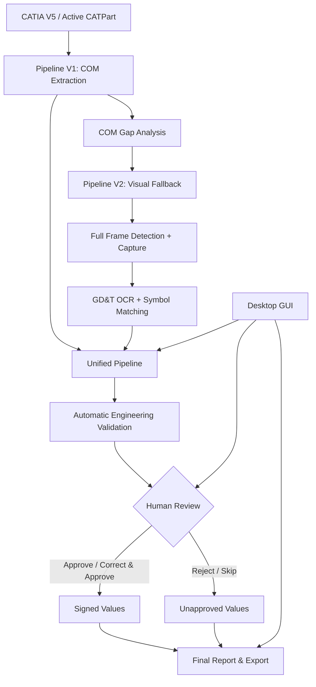

# CATIA Engineering Extractor

**CATIA V5 engineering data extraction • COM API • GD&T computer vision & OCR • Human-in-the-loop validation**

*Résumé (FR) : application desktop pour extraire les données d’une pièce CATIA V5, compléter les informations GD&T manquantes par vision/OCR, valider les valeurs avec un ingénieur, puis exporter les résultats structurés.*

A Windows desktop prototype that extracts CATIA part information, locates visual GD&T feature-control frames when COM metadata is insufficient, recognizes their contents, and produces traceable engineering reports and Excel/CSV/JSON exports.

> **Project status:** research / pilot (V1). The end-to-end workflow has been demonstrated on `Part_b.CATPart` with **2 visual GD&T annotations reviewed and approved**. These figures are from a limited pilot and **do not imply production-grade OCR accuracy** or independent certification of engineering correctness.

## Architecture



**Separation of responsibilities:** `pipeline_v1` and `pipeline_v2` remain independently callable; `pipeline_unified` orchestrates them and manages validation, final report assembly, and exports. The `frontend` package contains the GUI only. Algorithms shared across pipelines live in `catia`, `vision`, `ocr`, and `pipelines`.

## Project layout

```text
CATIA_Engineering_Extractor/
├── src/catia_extractor/
│   ├── catia/                # Windows COM adapters and engineering extractors
│   ├── domain/               # Data models / evidence status
│   ├── pipeline_v1/          # COM extraction + gap analysis runner
│   ├── pipeline_v2/          # Annotation selection and visual capture runner
│   ├── pipeline_unified/     # Orchestration, validator, review, reports, export
│   ├── frontend/             # Tkinter desktop application / Human Review UI
│   ├── ocr/                  # GD&T OCR + reference templates
│   ├── vision/               # Selection masks, frame detection and screenshots
│   └── pipelines/            # Shared legacy gap / evidence helpers
├── tests/
│   ├── unit/                 # Offline unit tests
│   ├── offline/              # Report/review/export workflow tests
│   └── integration/          # Historical live-CATIA experiments (opt-in)
├── docs/                     # Architecture and operating guidance
├── scripts/                  # Developer tools
├── pyproject.toml            # Reproducible Python dependencies
└── launch_CATIA_Studio.bat   # Windows double-click launcher
```

## Quick start — Windows / CATIA V5

Prerequisites: **Windows**, CATIA V5 (running with an open `.CATPart`), **Python 3.10+**, and the [Tesseract OCR](https://github.com/tesseract-ocr/tesseract) desktop executable installed and available on `PATH` (or configured using `pytesseract.pytesseract.tesseract_cmd`). CATIA automation requires a matching Windows COM environment. Keep the CATIA window visible during screenshot capture.

```powershell
# Run from the repository root (PowerShell)
py -m venv .venv
.\.venv\Scripts\Activate.ps1
python -m pip install --upgrade pip
python -m pip install -e ".[dev]"
tesseract --version

# Launch desktop interface
python -m catia_extractor.frontend.desktop_app
```

Alternatively, double-click `launch_CATIA_Studio.bat` **after installing dependencies with the same Python interpreter used by the launcher**. If several Python versions are installed, prefer the activated virtual environment and the command above.

In the application:
1. Open the part in CATIA V5 and select **Start Extraction**. The GUI minimizes to avoid covering CATIA during captures.
2. Review each captured GD&T image and choose **Approve**, **Correct & Approve**, **Reject**, or **Skip**. Approval is never automatic.
3. Open **Export Center** and select **Excel** (`.xlsx`), **CSV** (17-file `.zip`), or **JSON**, then save the output.

### Independent command-line stages

```powershell
$env:PYTHONPATH = "src"
python -m catia_extractor.pipeline_v1.runner            # COM extraction only
python -m catia_extractor.pipeline_v2.runner            # Vision + current OCR hook
python -m catia_extractor.ocr.run_from_pipeline2         # OCR of saved frames
python -m catia_extractor.pipeline_unified.runner       # COM → Vision → OCR → Validation
python -m catia_extractor.pipeline_unified.human_review # Interactive CLI review
python -m catia_extractor.pipeline_unified.final_report # Sign-off-aware final report
python -m catia_extractor.pipeline_unified.export_engineering
```

`catia_extractor.pipeline_unified.desktop_app` is retained as a compatibility entry point for earlier commands, but new UI development belongs in `frontend/`.

## Outputs and evidence policy

Runtime files are saved to local **`output/`**, which is intentionally excluded from Git:

| Directory | Main artifacts |
|---|---|
| `output/pipeline_v1/` | Full COM extraction and gap reports |
| `output/pipeline_v2/` | Full-frame images, vision report, OCR report |
| `output/pipeline_unified/` | Unified report, validation, human decisions, final report |
| `output/engineering_export/` | Excel workbook, per-sheet CSV files, complete JSON bundle |

The exported Excel workbook contains **17 thematic worksheets** (COM parameters/features, GD&T, datums, dimensions, OCR, validation, reviewer decisions and provenance). The complete JSON bundle preserves nested records that are flattened or shortened for tabular display.

**Engineering safeguards:** OCR output is provisional; the automatic validator can flag ambiguous measurements (e.g. a reported zero tolerance). Human review records the original and reviewed values, reviewer, timestamp, image hash and evidence fingerprint. If supporting evidence changes, old approvals must not be reused. Skipped/rejected results remain explicitly unapproved in exports. This is **not a replacement for qualified engineering judgment or drawing/model inspection**.

## Tests

```powershell
python -m compileall -q src/catia_extractor
python -m pytest -q                        # Offline unit and report-workflow tests
```

Live-CATIA scripts under `tests/integration/` require an interactive Windows/CATIA V5 session; they are **not** run in CI or the default pytest command. See [Testing and limitations](docs/TESTING.md).

## Documentation

- [Design, modules and data flow](docs/ARCHITECTURE.md)
- [Installation, workflow and troubleshooting](docs/USER_GUIDE.md)
- [Testing scope and known limitations](docs/TESTING.md)
- [Pilot V1 status and next research steps](docs/PROJECT_STATUS.md)
- [Contributing and branch workflow](CONTRIBUTING.md)

## Repository and data hygiene

This repository is intended to contain **source code, OCR symbol templates, tests and documentation** — not proprietary CATParts, screen captures, generated engineering reports, workstation paths or human review signatures. `.gitignore` excludes these runtime artifacts; if they were committed earlier, they must also be removed from the Git **index** in a later commit (see `docs/GIT_RELEASE.md`). Ignoring a file does not remove it from old Git history.

No open-source license is declared. Contact the repository owner before redistributing or reusing the code.
